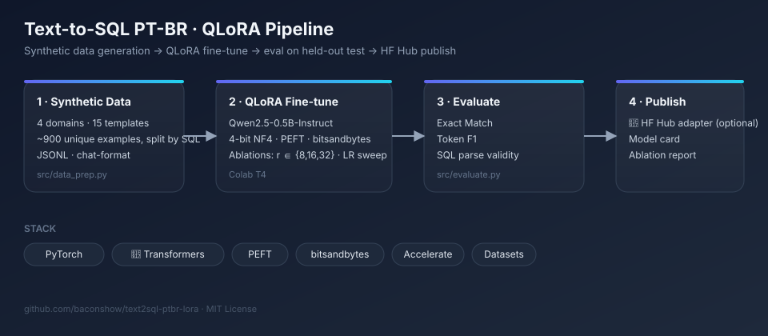

# Text-to-SQL PT-BR

QLoRA fine-tune of Qwen2.5-0.5B-Instruct that turns Brazilian Portuguese questions into SQL. The repo holds the synthetic data generator, four training configs, the evaluation and a Colab notebook that runs all of it.

[](https://colab.research.google.com/github/baconshow/text2sql-ptbr-lora/blob/main/notebooks/colab_train.ipynb)
[](LICENSE)



## Results

Not measured yet. `results/ablation_table.md` and `assets/loss_curves.png` appear here after the first full run of the notebook. No number in this repo comes from anywhere else.

| Run | LoRA r | Target modules | LR | Trainable params |
|---|---:|---|---:|---:|
| `base` | 16 | attention | 2e-4 | 2.16 M |
| `rank8` | 8 | attention | 2e-4 | 1.08 M |
| `rank32_allmodules` | 32 | attention + MLP | 2e-4 | 17.60 M |
| `lr_high` | 16 | attention | 5e-4 | 2.16 M |

## Design

| Decision | Choice | Why |
|---|---|---|
| Model | Qwen2.5-0.5B-Instruct | Fits a free T4 and runs on modest hardware. |
| Quantization | 4-bit NF4, double quant | The base model stays frozen and small in memory. |
| Loss | SQL answer tokens only | Prompt tokens are masked, so the model is not graded on copying the schema. |
| Precision | bf16 on Ampere or newer, fp16 on T4 | The T4 has no native bf16. |
| Data | Synthetic, about 900 unique examples | Spider and WikiSQL are in English. |
| Split | By gold SQL | A query in the test split never appears in train, even with other wording. |
| Metrics | Exact match, token F1, valid SQL | Valid SQL compiles the answer in SQLite against the example's own schema. |

## Dataset

`src/data_prep.py` is deterministic (`seed=42`). It samples one of 4 domains (e-commerce, HR, finance, healthcare) and one of 15 single-table templates: `SELECT *`, `COUNT`, `COUNT(DISTINCT)`, `AVG`, `SUM`, `MIN`, `MAX`, `ORDER BY ... LIMIT`, `GROUP BY`, `LIKE`, `BETWEEN`, and numeric and text `WHERE` filters.

The templates and value pools run out at about 900 unique examples, so `--n_samples 3000` stops there and says so. There are no joins, and test queries use the same templates and schemas as train. Scores measure new queries in known shapes, not new schemas.

```json
{
  "messages": [
    {"role": "system", "content": "Você é um assistente que converte perguntas em português para SQL."},
    {"role": "user", "content": "### Schema:\nCREATE TABLE ...\n\n### Pergunta:\nTraga todos os registros de funcionários."},
    {"role": "assistant", "content": "SELECT * FROM funcionarios;"}
  ],
  "domain": "rh",
  "template": "select_all"
}
```

## Run it

On Colab: open the notebook with the badge above, pick a T4 runtime and use `Run all`.

Locally, with a CUDA GPU:

```bash
git clone https://github.com/baconshow/text2sql-ptbr-lora.git
cd text2sql-ptbr-lora
pip install -r requirements.txt

python src/data_prep.py --output data --n_samples 3000 --seed 42

for cfg in base ablation_rank8 ablation_rank32_allmodules ablation_lr_high; do
    python src/train.py --config configs/$cfg.yaml
done

python src/evaluate.py --data data/test.jsonl
for run in base rank8 rank32_allmodules lr_high; do
    python src/evaluate.py --adapter runs/$run --data data/test.jsonl
done

python src/make_report.py --runs base rank8 rank32_allmodules lr_high
```

Try one question:

```bash
python src/inference.py --adapter runs/base \
    --schema "CREATE TABLE clientes (id INT, nome VARCHAR(100), cidade VARCHAR(50));" \
    --question "Quantos clientes temos em São Paulo?"
```

Tests need no GPU:

```bash
pip install pytest
pytest tests
```

## Layout

```
configs/      one YAML per run
src/          data_prep, train, evaluate, inference, make_report
notebooks/    the Colab runner
tests/        dataset, split, metrics and report checks
results/      ablation table, written by make_report
```

## Next

- Joins and sampled schemas, to test schemas the model has not seen.
- Execution accuracy: run the SQL on synthetic rows and compare result sets.

## License

MIT
