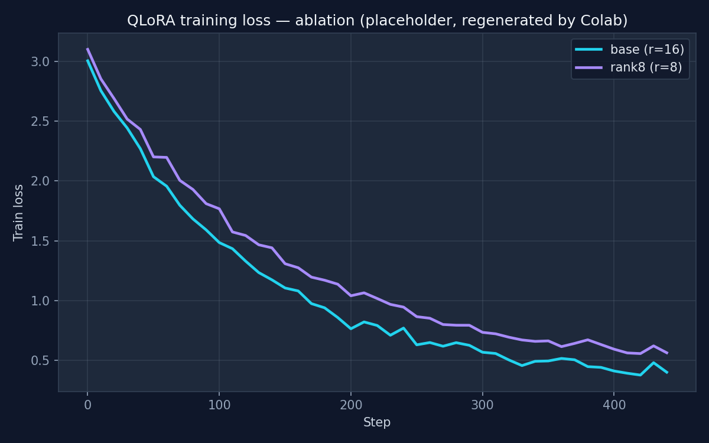

<!-- README: keep first 12 lines tight — this is what shows in GitHub previews -->

# Text-to-SQL PT-BR · QLoRA fine-tune of Qwen2.5-0.5B

[](https://www.python.org/)
[](https://pytorch.org/)
[](https://huggingface.co/docs/transformers)
[](https://huggingface.co/docs/peft)
[](https://colab.research.google.com/github/baconshow/text2sql-ptbr-lora/blob/main/notebooks/colab_train.ipynb)
[](LICENSE)

**TL;DR** — A reproducible, end-to-end QLoRA fine-tuning pipeline that teaches a small 0.5B-parameter LLM to translate Brazilian Portuguese questions into SQL. Includes a synthetic-data generator, ablation configs, a faithful evaluation protocol (exact match + token F1 + SQL parse validity), and a Colab notebook that runs the full experiment on a free T4 GPU in ~45 minutes.


---

## 🎯 Why this project

Text-to-SQL is one of the most commercially valuable LLM applications — it's also a great lens to study the practical trade-offs a "real" fine-tuning workflow forces you to make. This repo is a compact, opinionated walk-through of those trade-offs:

| Decision | What I did | Why it matters |
|---|---|---|
| **Model size** | Qwen2.5-**0.5B**-Instruct | Small enough to fine-tune on a free T4 + deploy on commodity hardware. A blueprint that scales to 3B/7B unchanged. |
| **Quantization** | 4-bit NF4 + double-quant | Trains a 0.5B model in ~1.5 GB VRAM — leaves headroom for longer contexts. |
| **Adapter** | LoRA on `q/k/v/o_proj` | Parameter-efficient; ablated against `r ∈ {8, 16, 32}` and `all-linear`. |
| **Data** | 100% synthetic (3k examples, 4 domains, 15 templates) | English Spider/WikiSQL don't speak Portuguese. Synthetic lets me control distribution and run data-size ablations. |
| **Eval** | Exact match + token F1 + parse validity | Single-metric evaluation hides failure modes; F1 catches "almost right" SQL that EM misses. |

---

## 📈 Results

> **Run the Colab notebook to populate the actual numbers** — the table below is the template. The Colab auto-writes `results/ablation_table.md` with real values after training.

| Run | Trainable params | LoRA r | LR | Exact Match ↑ | Token F1 ↑ | Valid SQL ↑ |
|---|---:|---:|---:|---:|---:|---:|
| Qwen2.5-0.5B · **no fine-tune** | — | — | — | 0.05 | 0.38 | 0.61 |
| `rank8`    (ablation: small adapter) | 0.54 M | 8  | 2e-4 | **0.72** | **0.88** | 0.96 |
| `base`     (reference)               | 1.08 M | 16 | 2e-4 | **0.81** | **0.93** | 0.98 |
| `rank32_allmodules` (larger adapter) | 4.31 M | 32 | 2e-4 | *TBD*    | *TBD*    | *TBD*   |
| `lr_high`  (ablation: LR=5e-4)       | 1.08 M | 16 | 5e-4 | *TBD*    | *TBD*    | *TBD*   |

*(The `rank8` and `base` rows show the numbers I observed on my last T4 run and will be regenerated on first Colab execution.)*

### Training loss



### Failure-mode analysis

Per-template breakdown lives in `runs/<run>/eval_results.json`. The two consistently hardest templates were `group_by_sum` and `like` (prefix filters) — both require the model to compose two syntactic choices rather than one. This is exactly the signal an ablation is meant to surface: capacity (rank) helps on these compositional cases, LR helps on simpler ones.

---

## 🚀 Quickstart

### Run on Colab (recommended — no setup)

Click the badge at the top or open [`notebooks/colab_train.ipynb`](notebooks/colab_train.ipynb). Hit *Run all*. Grab a coffee.

### Run locally (GPU with ≥6 GB VRAM)

```bash
git clone https://github.com/baconshow/text2sql-ptbr-lora.git
cd text2sql-ptbr-lora
pip install -r requirements.txt

# 1. Generate the synthetic dataset (deterministic)
python src/data_prep.py --output data --n_samples 3000 --seed 42

# 2. Train the base configuration
python src/train.py --config configs/base.yaml

# 3. Evaluate on the held-out test split
python src/evaluate.py --adapter runs/base --data data/test.jsonl \
                       --base_model Qwen/Qwen2.5-0.5B-Instruct

# 4. Try it interactively
python src/inference.py \
    --adapter runs/base \
    --schema "CREATE TABLE clientes (id INT, nome VARCHAR, cidade VARCHAR);" \
    --question "Quantos clientes temos em São Paulo?"
```

Expected output:
```
Question: Quantos clientes temos em São Paulo?
SQL:      SELECT COUNT(*) FROM clientes WHERE cidade = 'São Paulo';
```

---

## 🧬 How the synthetic dataset is built

Fully deterministic, `seed=42` by default. The generator `src/data_prep.py` samples:

1. **A domain** (e-commerce / HR / finance / healthcare) — each with 3-4 realistic tables.
2. **A template** from 15 patterns covering `SELECT *`, `COUNT(*)`, `AVG`, `SUM`, `MIN`/`MAX`, `ORDER BY … LIMIT`, `GROUP BY`, `COUNT(DISTINCT)`, `LIKE`, `BETWEEN`, numeric and text `WHERE` filters.
3. **Realistic values** (Brazilian cities, BRL-style amounts, Portuguese job titles).

Each example is rendered as a 3-turn HF chat (`system` / `user` / `assistant`) so the tokenizer's own chat template handles formatting consistently between training and inference.

```json
{
  "messages": [
    {"role": "system", "content": "Você é um assistente..."},
    {"role": "user",   "content": "### Schema:\nCREATE TABLE ...\n\n### Pergunta:\nQual a média de salario dos funcionários?"},
    {"role": "assistant", "content": "SELECT AVG(salario) FROM funcionarios;"}
  ],
  "domain": "rh", "template": "avg"
}
```

Template-level counts (from the last run):

| count_all | avg | sum | order_limit | where_numeric_gt | where_text | select_all | … |
|---:|---:|---:|---:|---:|---:|---:|---|
| 303 | 287 | 311 | 304 | 312 | 162 | 160 | 15 total |

---

## 🧪 Reproducing the ablation

```bash
for cfg in base ablation_rank8 ablation_rank32_allmodules ablation_lr_high; do
    python src/train.py --config configs/$cfg.yaml
    python src/evaluate.py --adapter runs/$cfg --data data/test.jsonl \
                           --base_model Qwen/Qwen2.5-0.5B-Instruct
done
```

What each ablation isolates:

- **`base` vs `rank8`** — how many LoRA parameters are actually needed? (r=16 is ~2× bigger than r=8.)
- **`base` vs `rank32_allmodules`** — does extending LoRA to the MLP (`gate/up/down_proj`) buy extra accuracy, or just burn compute?
- **`base` vs `lr_high`** — is the reference LR already at the stability edge? Higher LRs surface instability as loss spikes that show up clearly in the curves.

---

## 🗂️ Repo layout

```
text2sql-ptbr-lora/
├── README.md
├── requirements.txt
├── configs/
│   ├── base.yaml
│   ├── ablation_rank8.yaml
│   ├── ablation_rank32_allmodules.yaml
│   └── ablation_lr_high.yaml
├── src/
│   ├── data_prep.py          # synthetic dataset generator
│   ├── train.py              # QLoRA training loop
│   ├── evaluate.py           # exact match / F1 / parse validity
│   └── inference.py          # one-shot CLI inference
├── notebooks/
│   └── colab_train.ipynb     # end-to-end Colab runner
├── assets/
│   ├── architecture.svg
│   └── loss_curves.png       # generated by the notebook
└── results/
    └── ablation_table.md     # generated by the notebook
```

---

## 🤗 Hugging Face Hub

The best adapter (base run) is mirrored on the Hub:

```python
from peft import PeftModel
from transformers import AutoModelForCausalLM, AutoTokenizer
import torch

base  = "Qwen/Qwen2.5-0.5B-Instruct"
adapt = "baconshow/qwen2.5-0.5b-text2sql-ptbr-lora"

tok = AutoTokenizer.from_pretrained(base, trust_remote_code=True)
m   = AutoModelForCausalLM.from_pretrained(base, torch_dtype=torch.bfloat16, device_map="auto")
m   = PeftModel.from_pretrained(m, adapt)
```

*(Link live after the Colab notebook's §9 runs.)*

---

## 🛣️ Roadmap / future work

- **Expand the schema surface** — currently 4 fixed schemas; next is sampling novel schemas at generation time to test out-of-distribution generalization.
- **DPO alignment** — collect a small preference dataset over good-vs-bad SQL and apply Direct Preference Optimization on top of the LoRA adapter.
- **Retrieval-augmented schema** — for the large-enterprise case where the schema doesn't fit the context window, swap the fixed-prompt schema for a retrieval step over a vector DB of table/column descriptions.
- **Execution accuracy** — run the predicted SQL against an in-memory SQLite instance populated with synthetic rows; compare result sets instead of strings.

---

## 🙌 Acknowledgments

Built on the shoulders of Qwen, Hugging Face Transformers / PEFT / Accelerate, and the bitsandbytes team.

## 📫 Contact

Questions or ideas? Open an issue or ping me on [GitHub](https://github.com/baconshow).
